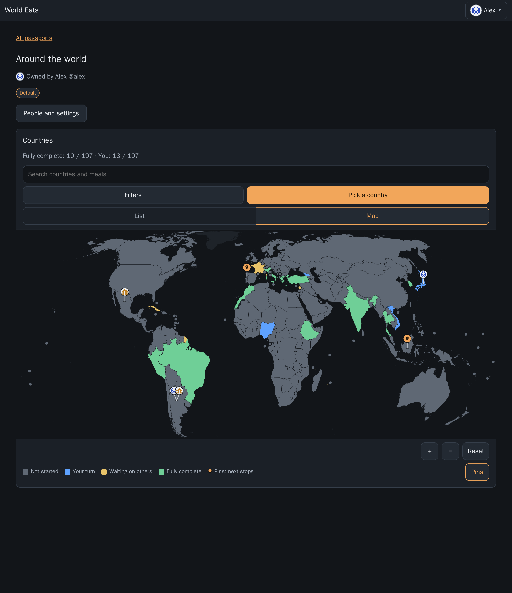
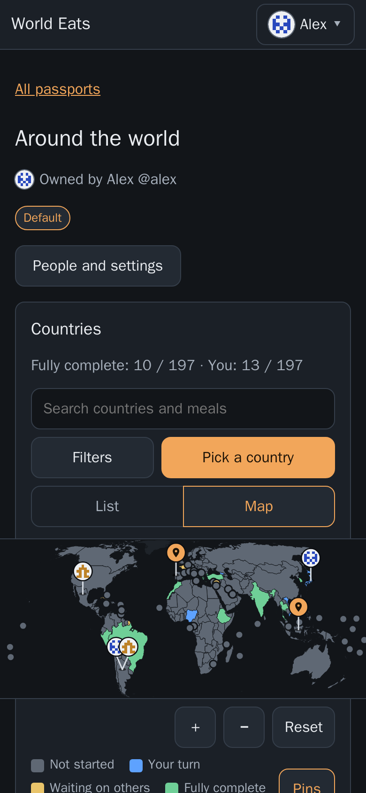
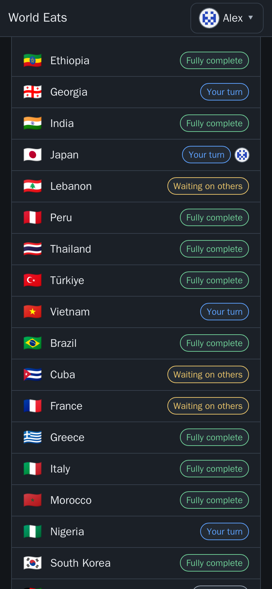
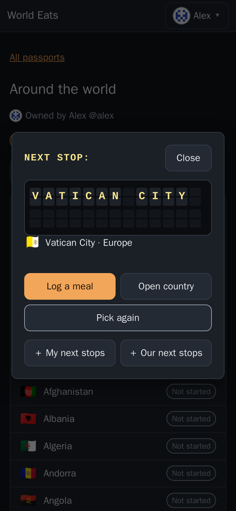
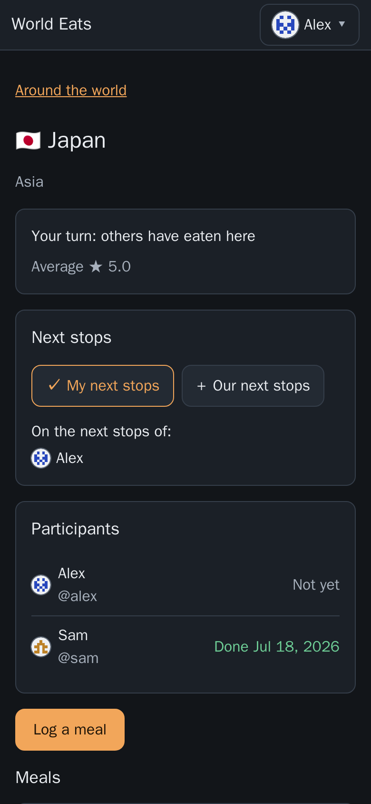

# World Eats

[](https://github.com/dskindell/world-eats/actions/workflows/tests.yml)

> **Beta.** World Eats works and is in regular use, but it's young: expect rough edges, and back up your data before upgrading.

A small self-hosted web app for a "eat a meal from every country" challenge. Pick a random country, eat a meal from it (usually at a restaurant), log what you had, and watch the world map fill in.

It is dependency-free: Python standard library only (`http.server` and `sqlite3`) on the server, vanilla JS/HTML/CSS in the browser, no build step, and no requests to outside services at runtime. Dark theme, designed phone-first.



<p>
  
  
  
  
</p>

The screenshots use sample users (Alex and Sam).

## Contents

- [Features](#features)
- [Known limitations](#known-limitations)
- [Run](#run)
- [Configuration](#configuration)
- [Behind a reverse proxy](#behind-a-reverse-proxy)
- [Security notes](#security-notes)
- [If no admin can log in](#if-no-admin-can-log-in)
- [Login lockout](#login-lockout)
- [Backup](#backup)
- [Country list](#country-list)
- [World map](#world-map)
- [Tests](#tests)
- [Future ideas](#future-ideas)
- [Layout](#layout)
- [Security policy](#security-policy) and [License](#license)

## Features

- **Accounts without sign-up.** The first visit to a fresh install shows a setup page that creates the first admin. After that, admins create, disable, delete and promote users, reset passwords and unlock locked accounts. Sessions last 30 days and can run on several devices; "Log out everywhere" is in account settings.
- **Passports.** A passport is one challenge. Every account gets a personal passport (named "My passport"; it can't be deleted and can't have participants). You can also create shared passports, up to 50 owned per user and 20 people each. *Participants* each log their own meals; *viewers* can see everything but can't log. Only the owner renames or deletes a passport or changes who is in it. You can choose which passport the app opens to.
- **Meals.** Log the date, what you ate, where, a 1-5 star rating and notes (all optional except the date). You can log several meals per country, and edit or delete your own. A country counts as done for you once you have logged a meal there, and is *fully complete* when every active participant has.
- **Search, sort and filters.** Search ignores case and accents and matches country names, alternative names (for example "Burma" finds Myanmar) and everyone's meals. Sort by name, region, date completed, rating or progress; filter by status, who has done it, region and minimum rating. The state is kept in the page address.
- **Random pick.** "Pick a country" chooses at random among the countries you haven't done that match the current search and filters, and reveals it on an airport split-flap departure board (it respects the browser's reduced-motion setting). The pick isn't saved.
- **World map.** Equal Earth projection, drawn from bundled Natural Earth data. Countries are coloured by status: in a shared passport each participant sees *Not started*, *Your turn* (someone else has eaten there, you haven't), *Waiting on others* (you have, someone else hasn't) and *Fully complete*, and the list and filters use the same states. Tap one to see a summary card, and zoom with pinch, mouse wheel and drag, or the +, - and Reset buttons. Tiny countries appear as dots. A List / Map switch sits under the search bar.

## Known limitations

- **Plain HTTP only.** For HTTPS, put your own reverse proxy in front (see [Behind a reverse proxy](#behind-a-reverse-proxy)).
- **One server, one SQLite file.** It's built for a household or a small group on a single host, not for many users or several replicas.
- **English only.**
- **Map colours and red-green colour blindness.** The yellow (*Waiting on others*) and green (*Fully complete*) map colours can be hard to tell apart; the list, legend and country cards always show the state in words.

## Run

Requirements: Docker with Compose.

```bash
mkdir -m 700 data      # owned by you; compose runs the app as UID/GID 1000 to match
docker compose up -d --build
```

The app is then on host port 7197 (`http://localhost:7197`). The compose file builds the image locally, runs it as a read-only container with all capabilities dropped, and mounts `./data` as `/data`.

If your user isn't UID 1000 (`id -u`), change `user:` in `docker-compose.yml` to match. Without a `user:` line the image runs as UID 10001, and `./data` must then be owned by 10001.

Open the app and create the first account on the setup page. **Complete setup before exposing the app to anyone else:** until an account exists, whoever opens the app first becomes admin.

## Country list

197 countries: the 193 UN member states plus Kosovo, Palestine, Taiwan and Vatican City. Codes are ISO 3166-1 alpha-2 (Kosovo uses `XK`). Regions follow the UN M49 scheme, grouped into six continents (the Americas split into North America, including Central America and the Caribbean, and South America); Taiwan and Kosovo, which M49 doesn't list, are placed in Asia and Europe. The list is in `app/countries.py`.

## Configuration

Environment variables (set in `docker-compose.yml`):

| Variable | Required | Default | Meaning |
|---|---|---|---|
| `WORLD_EATS_ALLOWED_HOSTS` | yes | - | Comma-separated hostnames the app answers to, e.g. `localhost` or `eats.example.com,192.0.2.10:7197`. An entry without a port matches any port. No wildcards. Requests for any other host get `421`. The app won't start without it. |
| `WORLD_EATS_SECURE_COOKIES` | no | `false` | Set `true` when the app is served over HTTPS. Don't set it on plain HTTP: browsers will refuse the cookie and login won't work. |
| `WORLD_EATS_TRUSTED_PROXIES` | no | empty | Comma-separated IP addresses of your reverse proxy. Only then does the app read `X-Forwarded-For` to get the visitor's real IP for the login lockout. |
| `DATA_DIR` | no | `/data` | Where the database lives. |
| `PORT` | no | `8080` | Port inside the container. |

## Behind a reverse proxy

The app serves plain HTTP; put your own reverse proxy in front for HTTPS.

- The proxy must pass the original `Host` header through (nginx: `proxy_set_header Host $host;`), and that host must be in `WORLD_EATS_ALLOWED_HOSTS`. Otherwise every request gets `421`, or every change gets `403`.
- Set `WORLD_EATS_TRUSTED_PROXIES` to the proxy's IP. Without it, every visitor appears to come from the proxy, so five wrong passwords from anyone lock out logins for everyone for 15 minutes.
- Set `WORLD_EATS_SECURE_COOKIES=true`.

## Security notes

- **Give World Eats its own hostname.** Browsers don't keep cookies separate by port, so if you reach the app by IP address and port (e.g. `http://192.0.2.10:7197`), every other web service on that IP receives your World Eats login cookie. A compromised service there could use it to act as you, including as an admin. Use a dedicated hostname (and HTTPS) before you rely on the app, and before you create a second admin.
- **Deleting an account removes its data from the database file** (the app overwrites deleted content), but **backups made before the deletion still contain it**, and old copies can linger in the database's `-wal` file until SQLite next checkpoints it.
- **Every logged-in user can see every username** (to add people to passports), so anyone with an account can lock another account out for 15 minutes by typing wrong passwords. An admin can use Unlock.
- **Admins can reset any password, which gives them access to that account.** The user will notice, because they're logged out everywhere and their password stops working.

## If no admin can log in

Setup never reopens once an account exists, so if every admin is locked out (forgotten password, or a new admin's temporary password expired), reset one from the server. Replace `NAME` with the username. The command makes that account an enabled admin, logs it out everywhere, and sets a temporary password you type (12-128 characters, not shown) that must be changed at the next login:

```bash
docker exec -it world-eats python -c "
import getpass, sqlite3, time, auth
h = auth.PasswordHasher().hash(auth.require_new_password(getpass.getpass('Temporary password: ')))
c = sqlite3.connect('/data/world-eats.db')
n = c.execute('UPDATE users SET password_hash = ?, must_change_password = 1, temp_password_set_at = ?, disabled = 0, is_admin = 1 WHERE username = ? COLLATE NOCASE', (h, int(time.time()), 'NAME')).rowcount
c.execute('DELETE FROM sessions WHERE user_id = (SELECT id FROM users WHERE username = ? COLLATE NOCASE)', ('NAME',))
c.commit(); print('updated' if n else 'no such user')
"
```

If the admin is only locked out by too many wrong passwords, wait 15 minutes or restart the container instead.

## Login lockout

Five wrong passwords for a username within 15 minutes lock that username for 15 minutes; the same limit applies per client IP. This is a deliberate trade-off: anyone who can reach the login page can keep a known username locked by typing wrong passwords. Wrong passwords typed in account settings (changing your password, deleting your account) count toward the same per-username limit. The lockout resets when the container restarts.

## Backup

Everything is in the one SQLite file. Don't copy it with `cp` while the app is running (the copy can be inconsistent). Use SQLite's online backup instead:

```bash
docker exec world-eats python -c "import sqlite3; sqlite3.connect('/data/world-eats.db').backup(sqlite3.connect('/data/backup.db'))"
```

This writes `backup.db` next to the database (`./data/backup.db` on the host); copy that file to your backup location.

## World map

Made with [Natural Earth](https://www.naturalearthdata.com/) (public domain). The map shows Natural Earth's de facto borders; the app's country list counts Kosovo, Palestine and Taiwan as countries, and draws Somaliland, Northern Cyprus and Siachen Glacier as part of Somalia, Cyprus and India.

`app/static/map.json` is generated, not hand-edited. To regenerate it (the app itself never downloads anything):

```bash
mkdir /tmp/ne && curl -fL -o /tmp/ne/ne_50m_admin_0_countries.geojson \
  https://raw.githubusercontent.com/nvkelso/natural-earth-vector/9380cca83db5f9aef52d5e762765100745f84b27/geojson/ne_50m_admin_0_countries.geojson
python3 -I tools/build_map.py /tmp/ne/ne_50m_admin_0_countries.geojson app/static/map.json
```

The script refuses any input whose SHA-256 isn't `3e458fc036ad0a66411f2c1e6cac49c5d7bfb81cb1123bc513b22511a2b7fdeb`. Download outside the repo (`*.geojson` is gitignored).

## Tests

```bash
docker run --rm -v "$PWD":/src:ro -w /src python:3.12-slim python -m unittest discover -s tests -t . -v
```

The same suite runs on GitHub Actions for every push and pull request (`.github/workflows/tests.yml`). It needs only Python 3.12; there are no dependencies to install.

## Future ideas

Ideas that might be explored one day. They're not commitments, and there's no timeline.

- More reveal styles for the random pick (spin a globe, throw a dart at the map, a passport stamp).
- Signing in with an OpenID Connect provider (for example Authentik).
- Email, notifications and self-service password reset.
- Export and import.
- Backups from inside the app.
- A globe view as an alternative to the flat map.
- A per-passport setting for how many meals each person must log before a country counts as complete.
- Photos on meals.
- Map pins for where a meal was eaten.
- A light theme.

## Layout

- `app/server.py` - HTTP server, routing and request handling.
- `app/auth.py`, `app/config.py`, `app/db.py`, `app/countries.py`, `app/meals.py`, `app/passports.py`, `app/search.py` - validation, passwords and lockout; configuration; SQLite schema and migrations; the country list; meals; passports; search.
- `app/static/` - frontend (vanilla HTML/JS/CSS, no build step) and the generated `map.json`.
- `app/Dockerfile` - the image (Python 3.12 slim, runs as a non-root user).
- `tests/` - `unittest` suite (stdlib only).
- `.github/workflows/tests.yml` - runs the test suite on GitHub Actions.
- `tools/build_map.py` - builds `app/static/map.json` from Natural Earth data (run by hand; not in the image).
- Data: one SQLite database in `/data` inside the container, `./data` next to the compose file on the host (gitignored).

## Security policy

See [SECURITY.md](SECURITY.md) for how to report a vulnerability.

## License

MIT; see [LICENSE](LICENSE).
